# Assignments

The following describes a repository that contains a combined file for Assignments 1 & 2. I have listed the instructions and commentary for each. The .ipynb file itself is organized in the same fashion.
The repository is located [here](https://github.com/rlukkoor/CSUSM/tree/main/Fall%202026/OM%20620/Assignments/Assignments_1%262).

## Assignment 1

### Question 1 — DataFrame Formatting
As you load and inspect your transaction dataframe, you'll notice the column names don't follow a consistent convention. Make the necessary changes to ensure all column names follow the same convention as the metadata.

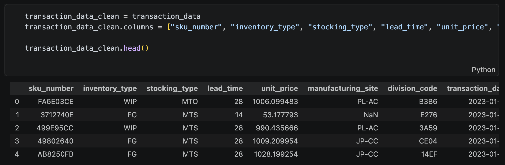

After loading the metadata and transaction datasets as dataframes, I noticed that three columns in the transaction data ("sku_numb3r", "Manufacturing Site", and "division Code") did not match their corresponding names in the metadata (all listed under the "feature" column). I first created a new variable ```transaction_data_clean``` and set it equal to transaction_data. Then I created a list to assign the new column names directly to ```transaction_data_clean```.

### Question 2 — Data Inspection
Inspect the numeric features of your dataframe with the `describe` function. Provide a summary of these features, and in case there are any oddities/anomalies in your dataframe, locate and correct them.

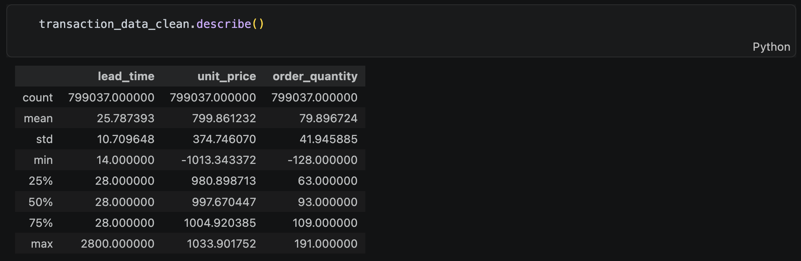
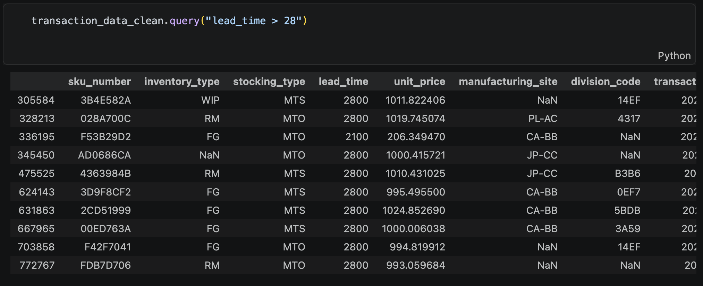

The describe function identifies lead time, unit price and order quantity, which all may require further examination. The min value for unit price and order quantity show as negative. The max lead time of 2800 seems to be an anomaly. 
I decided to drop all the 10 rows that contain a lead time greater than 28. Nine of those 10 rows showed a lead time of 2800 and the 10th row showed 2100. I assumed that these records may inflate or distort a dataset if I continued to use them.

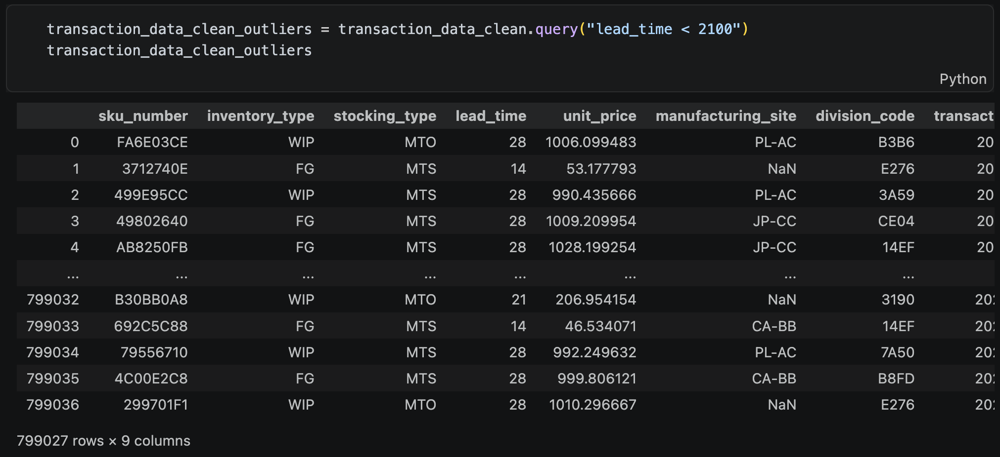

I filtered out all 10 of the previously determined lead_time outliers, reducing the total number of rows from 799037 to 799027.

### Question 3 — NaN Values
Your transactional dataset includes many missing values. Find and address (in your dataframe) the missing values by column.

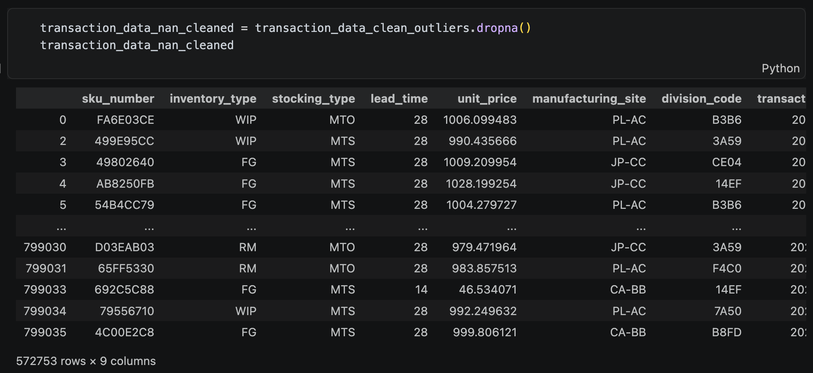

Using the dropna function, I effectively removed all NaNs from the transactional data and renamed the dataset to transaction_data_nan_cleaned. I did this in order to clean the data from all NaN as I did not want to assign a possible incorrect value, which could skew the data.


### Question 4 — Extracting the Country Values
To apply broader breakdowns of your transactional dataset, it will be helpful to add a country column. Recall that the metadata indicates the country information is somewhat captured in the site column.
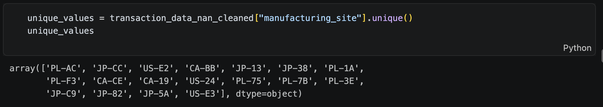
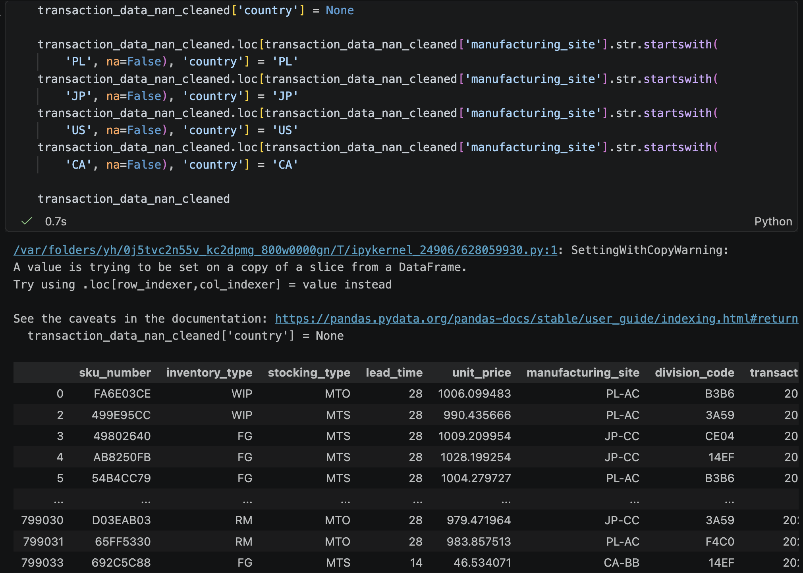

I started by using the unique() function to see how many different countries are listed under the manufacturing_site column. From this I got 4 countries: JP, CA, US, and PL. Using the str.startswith() function, I took the first two characters from the manufacturing_site column and placed them in a new column called country.

### Question 5 — Helpful Dimensional Information
It's time to focus on the subset of this dataset we need. Since we ultimately want to calculate safety stock, focus on finished goods designated as "make to stock." Create a filtered subset of your transaction dataset and write appropriate code to answer the following questions (for the filtered data):
- How many unique SKUs are we working with?

    - I used ```unique()``` on the sku_number column to identify 599 unique sku numbers.

- How many unique Manufacturing Sites are we working with?

    - I used ```unique()``` on the manufacturing_site column to identify 18 unique manufacturing sites.

- How many Divisions are we working with?

    - I used ```unique()``` on the division_code column to identify 54 unique divisions.

- What are the top and bottom 10 transactions by order quantity?

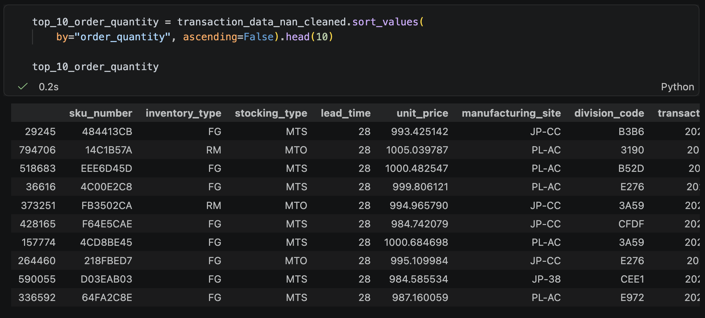
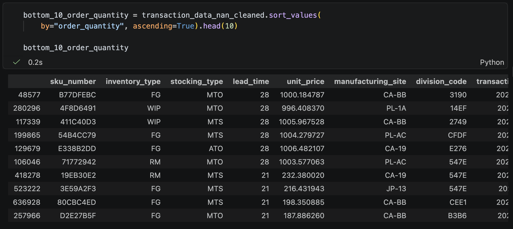

I used sort_values() on the order_quantity column to identify the top and bottom 10 transactions by order quantity. These were differentiated by changing ascending = False to ascending = True.

- What are the top and bottom 10 transactions by total sales value?

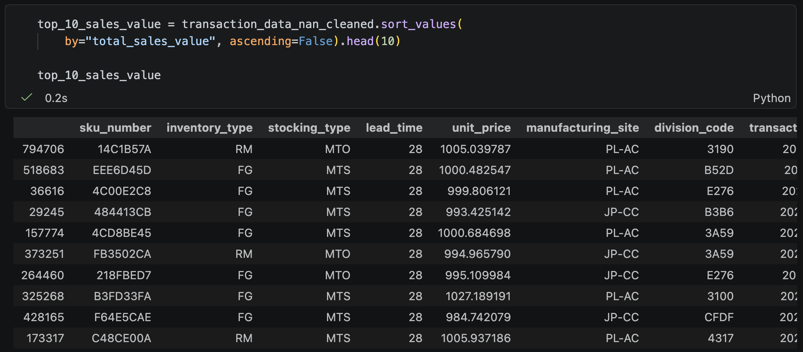
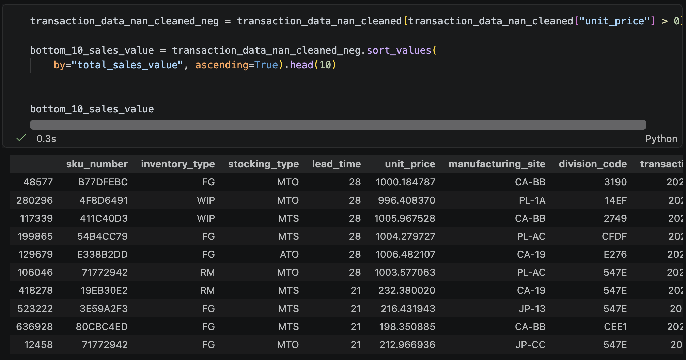

To calculate total sales value, I multipled the unit_price and the order_quantity columns. I created a new column called total_sales_value and placed the calculated values there. I decided to filter out rows with negative unit_price because negative unit price doesn't make sense, while negative order_quantity could refer to backorders or returns. I used sort_values() on the total_sales_value column to identify the top and bottom 10 transactions by total_sales_value. These were differentiated by changing ascending = True to ascending = False.

---

## Assignment 2

### Data Cleaning
Further cleaned the data based on the professor's feedback for Assignment 1. Focused on outliers, typos, and NaN values.

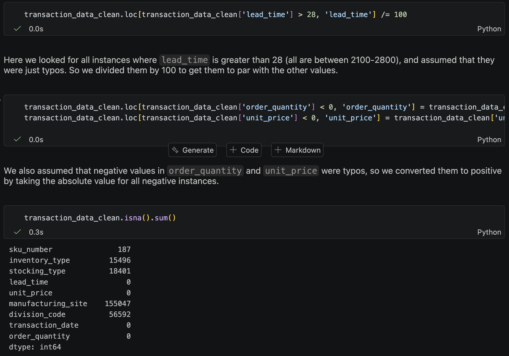
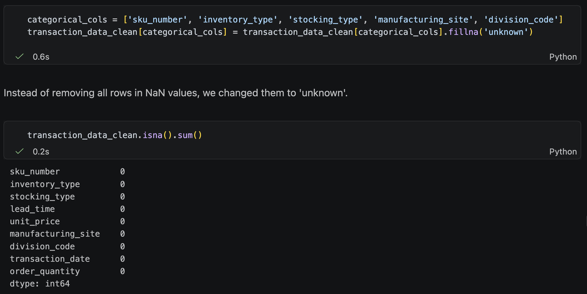
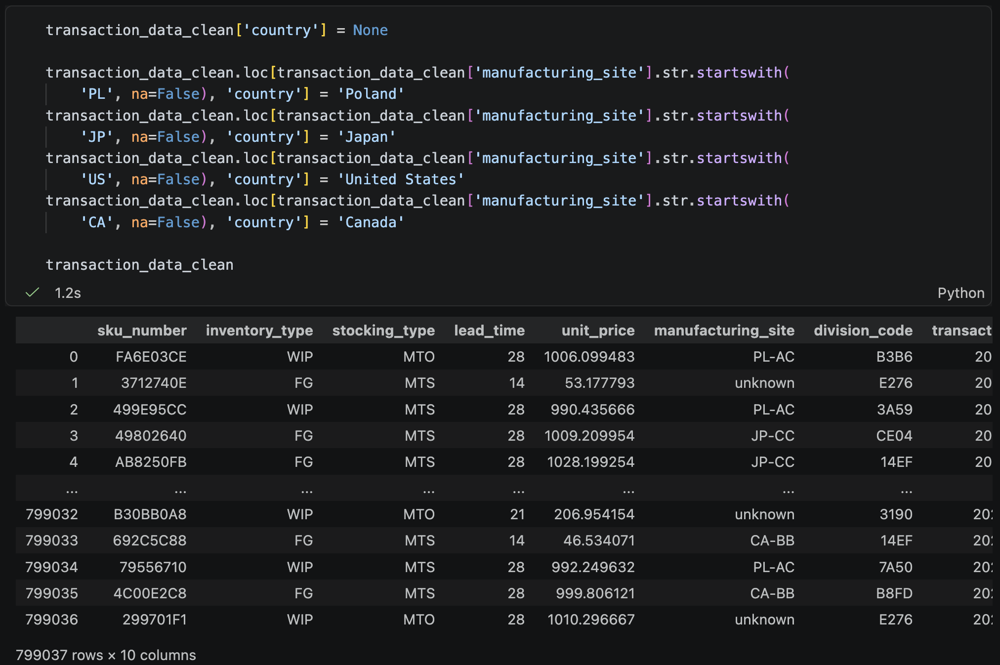

First I looked for all instances where lead_time is greater than 28 (all are between 2100-2800), and assumed that they were just typos. So U divided them by 100 to get them to par with the other values. Then I also assumed that negative values in order_quantity and unit_price were typos, so I converted them to positive by taking the absolute value for all negative instances. Instead of removing all rows in NaN values, I changed them to 'unknown'. Finally, I included the full country names, instead of abbreviating them.


### Question 1 — Required Transformation
Create a transformed dataset to filter for appropriate SKUs that are also aggregated with the following statistics:
- Minimum of quantity
- Maximum of quantity
- Average of quantity
- Median of quantity
- Variance of quantity
- Standard deviation of quantity
- Average lead time

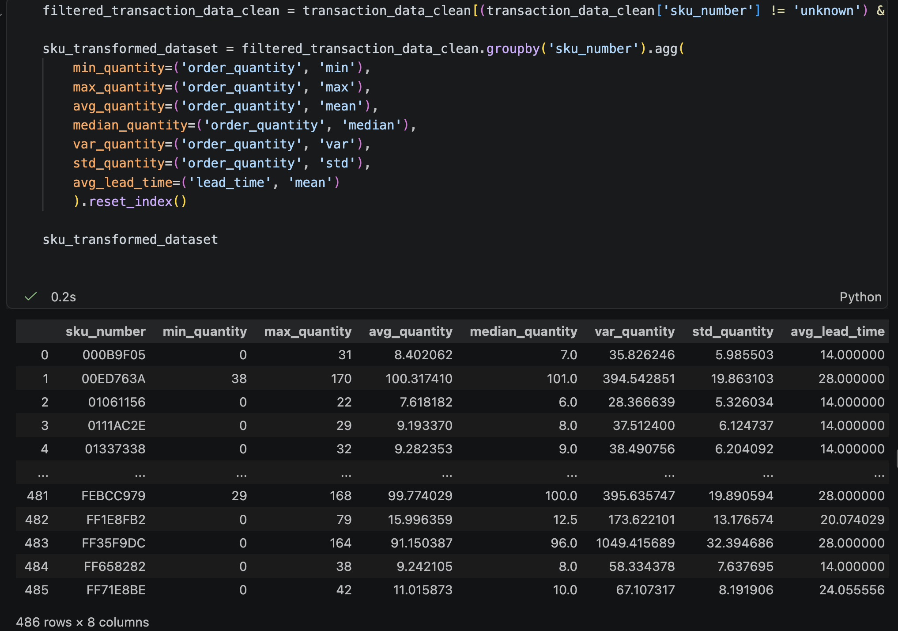

First, I filtered out all rows where sku_number is unknown, and kept only the rows where stocking_type is set to 'MTS'. Then I aggregated with the specified statistics. For each SKU, I calculated the minimum, maximum, average, median, variance, and standard deviation of order quantity, along with the average lead time. This resulted in 486 unique SKU numbers.

### Question 2 — Safety Stock Calculation
Use the transformed data from Question 1 to calculate three safety stock values for each SKU for the service level coefficients of 75%, 90%, and 95%.

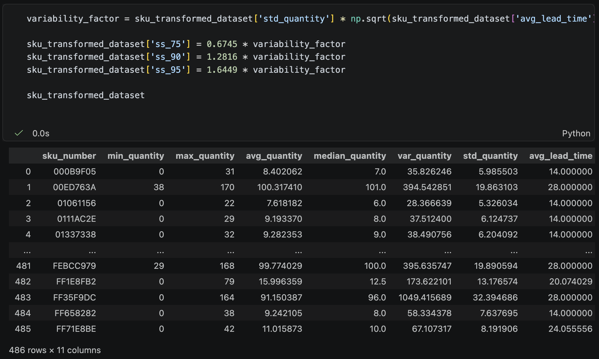

I calculated the safety stock values for each SKU for the service level coefficients of 75%, 90%, and 95%. I found the z-scores by inputting numeric values from standard normal distribution functions. I broke down the formula from the assignment instructions into 2 separate steps.


### Question 3 — Safety Stock Distribution
Now that we have the safety stock values, write appropriate code to answer the following questions. For this question, you may focus on the 95% service level coefficient.
- Which SKU has the largest safety stock?

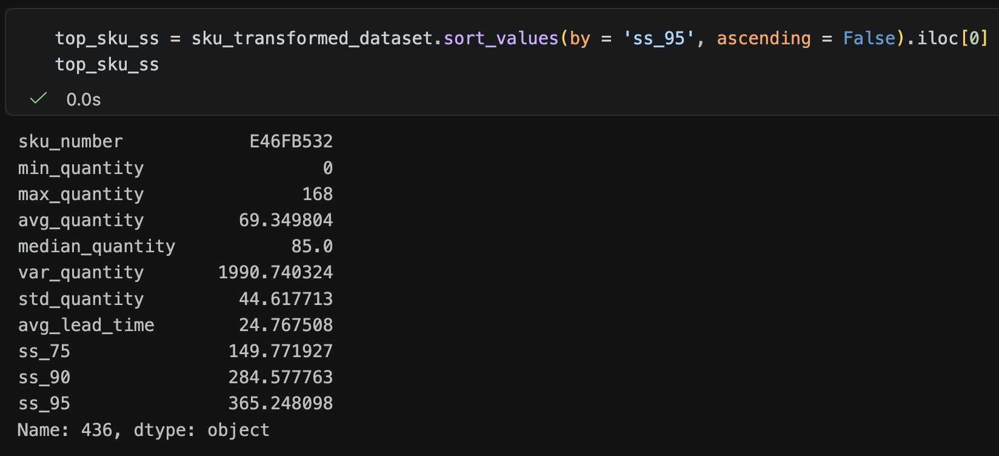

I sorted ss_95 from largest to smallest and used iloc to find the value of the first row.

- Which SKU has the smallest safety stock?

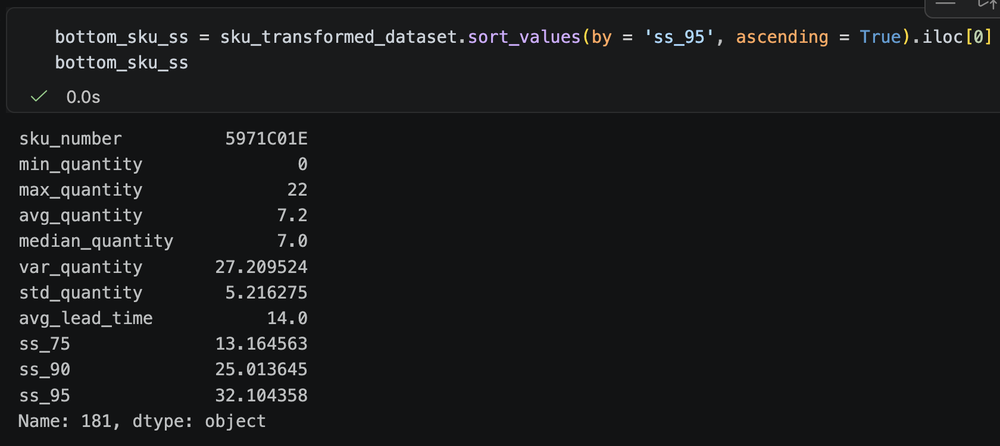

I sorted ss_95 from smallest to largest and used iloc to find the value of the first row.

- What is the average safety stock value across all SKUs?

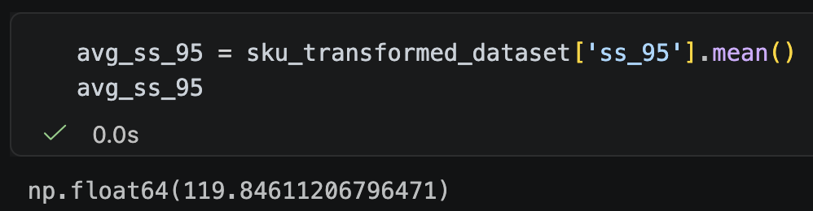

I directly applied mean() to the ss_95 column.

### Side Quest

The above safety stock calculation formula is one of the most popular approaches in practice, but it relies on a rather strong assumption that the underlying demand is normally distributed. A quick visualization of many SKUs reveals a non-normal distribution for many of them, which poses some risk.

You can receive a 15% extra point on this assignment if, in addition to the above formula, you also calculate the safety stock values using a simple non-parametric quantile function.

Note 1: I strongly suggest researching quantiles and empirical quantiles to learn more about them before making your calculation.

Note 2: The reason the simple quantile function is referred to as non-parametric is that we do not assume the demand follows the parametric normal distribution.

Note 3: The simplest approach to calculate specific empirical quantities in Python is using the mquantiles function of the scipy.stats.mstats module in the scipy package.

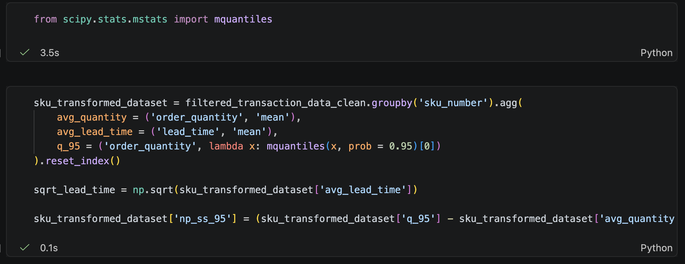
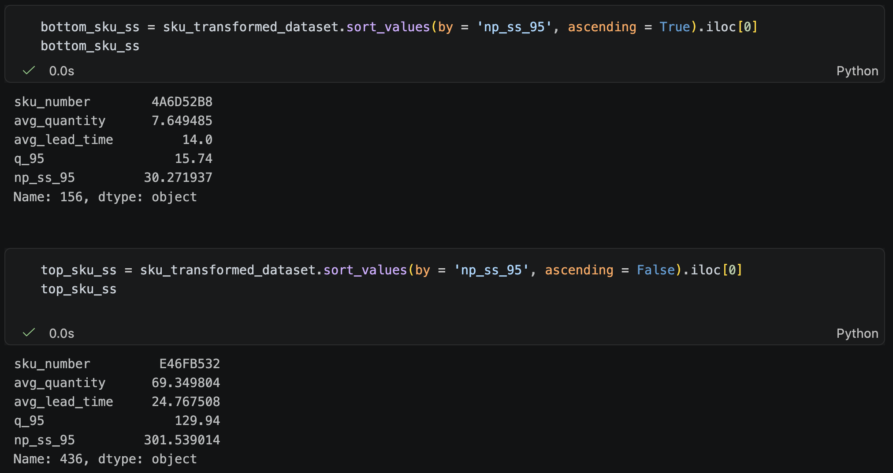
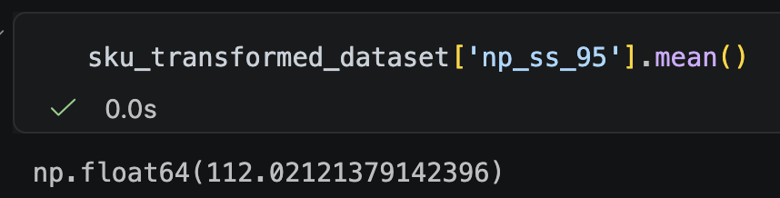

I grouped my transaction data by SKU to calculate the average order quantity, average lead time, and the 95th percentile of historical order quantities. I then calculated our non-parametric safety stock by subtracting the average order quantity from the 95th percentile and multiplying the difference by the square root of average lead time. Then, like I did for Problem #3, I calculated the SKUs with the largest and smallest safety stocks (for the 95th percentile), as well as the average safety stock value across all SKUs. As expected, when comparing these values to the values from Problem #3, I saw some differences: the mean value is slightly lower and the SKU number for smallest safety stock is different. For the largest safety stock, the SKU number is the same for both.