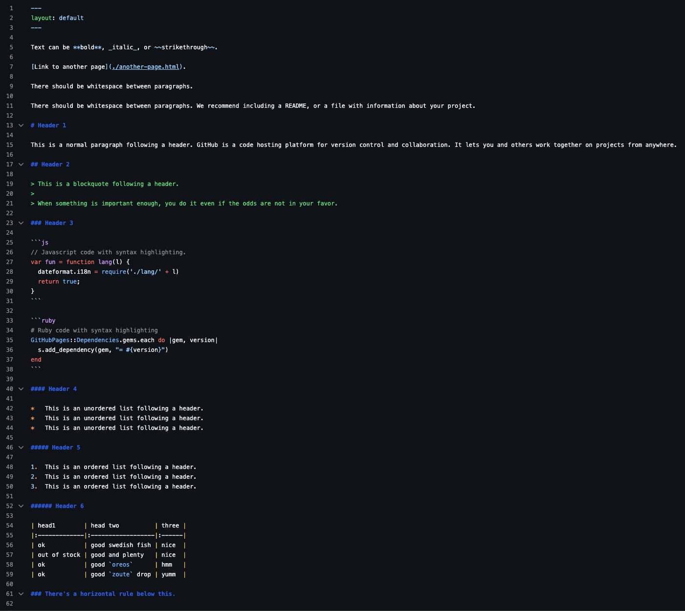
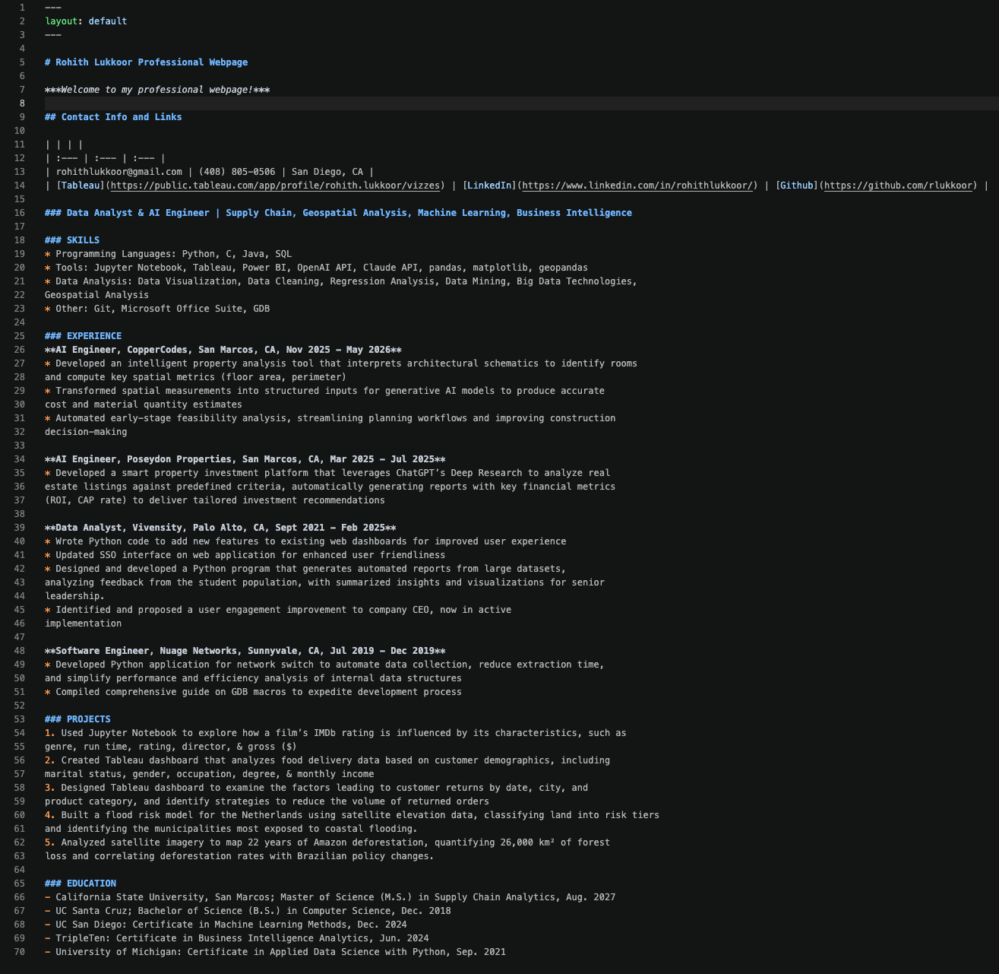
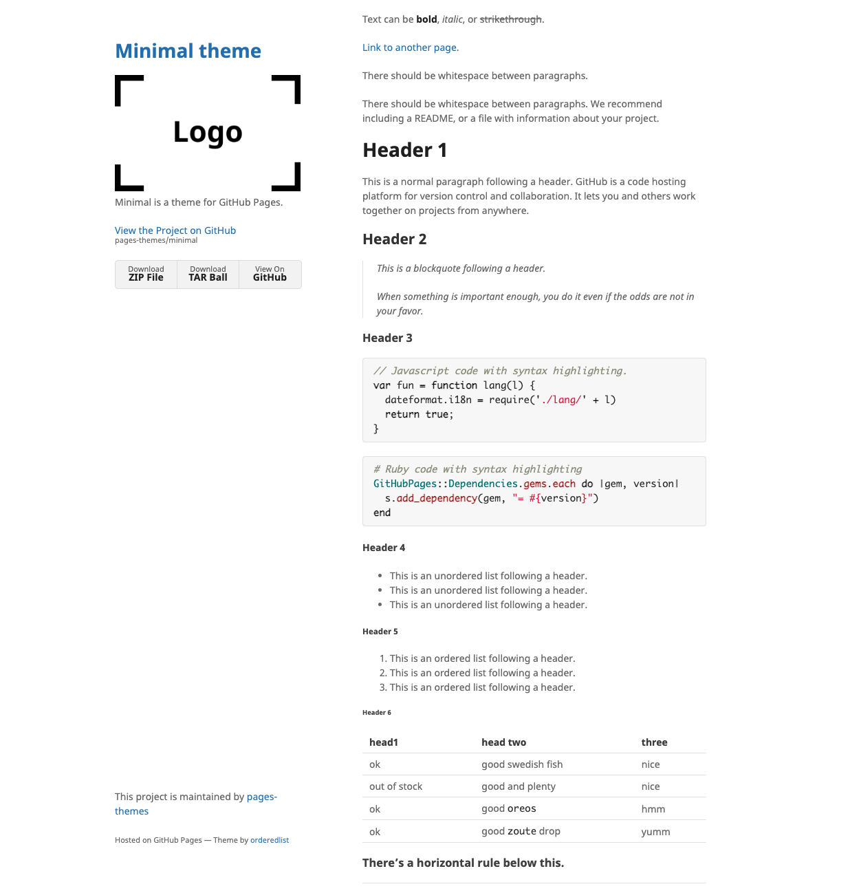
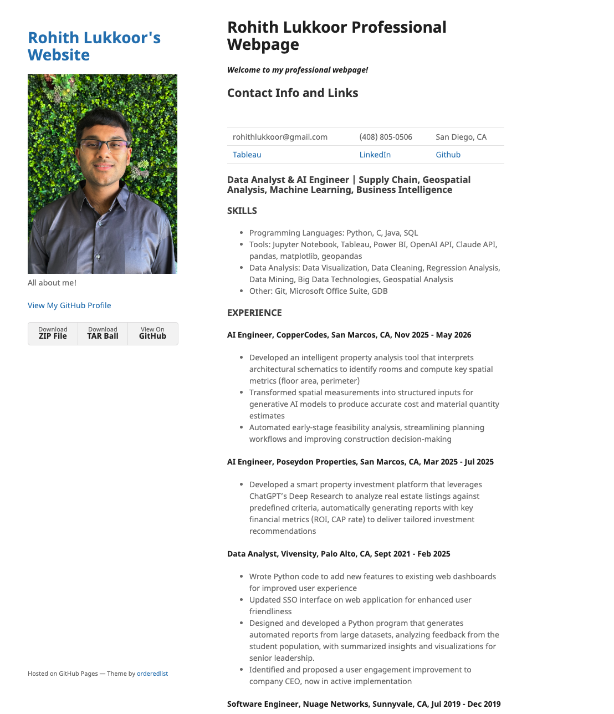
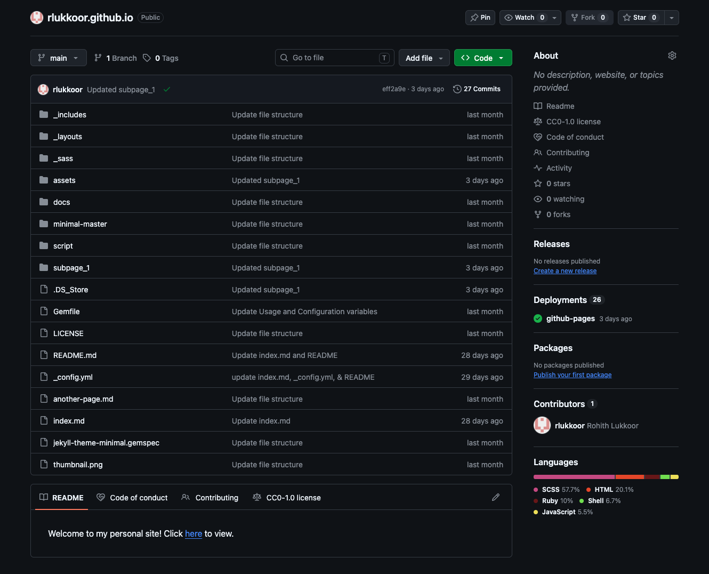

## Introduction
Here I will explain how I created my [e-portfolio](https://rlukkoor.github.io/). This will include the following:

* All the steps I took from creating my personal GitHub page to creating my e-portfolio
* Screenshots that illustrate the changes I made to the base minimal theme

## Changes

I started by downloading the [minimal](https://github.com/pages-themes/minimal/) theme from GitHub, unzipping it, and placing the contents of the folder in the ```rlukkoor.github.io``` folder on my machine. Then I committed it and pushed the changes to my GitHub account. At this point, my website looked exactly like the the demo on Minimal's website.

I then set up the theme using the instructions included in the "Usage" and "Configuration" variables of the README file of the minimal page. This process took place within the ```_config.yml``` folder. These include the title, description, and setting up the remote theme (minimal).

I then replaced the logo.png stock photo with my own headshot, keeping the same file name for simplicity's sake.

Then I started rewriting ```index.md``` with my personal/professional information. In general, I kept it to a resume-like structure, filling in my contact info, skills, education, projects, and experience. I was required to use at least 5 different types of markdown commands. My final deliverable used the following:

1. Headers (Levels 1, 2, & 3)
2. Italicized text
3. Bold text
4. Tables
5. Ordered list
6. Unordered list
7. Links

I kept certain sections of the original minimal demo, and just rewrote the text to fit my personal information. Other sections, like the images, nested lists, and inline code were completely removed.

Lastly, I made a final commit to GitHub, checked that my deployment was successful, and ensured that my e-portfolio page was live.

## Before and After

Below, I have included screenshots of the actual code of both the minimal theme and my own page. (Only the top portion of the page is captured)





I have also included screenshots of both the original Minimal demo page and my updated/personalized page with all the aforementioned changes.





Below is a screenshot of my GitHub Repository page, which includes my README, which I modified from its original demo version.




